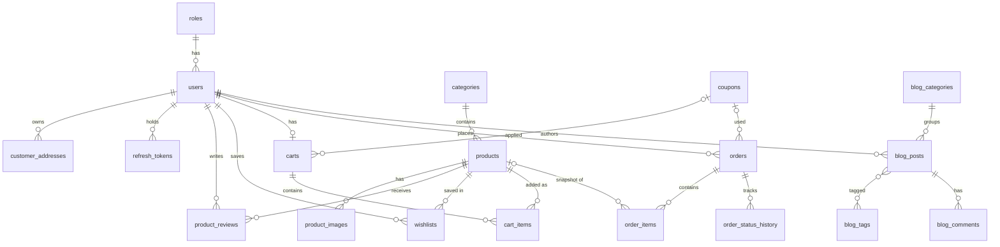

# Ogani Food Store

An online grocery store: a **Spring Boot 4 REST API** backed by **PostgreSQL**, with a storefront based on the
[Ogani](https://colorlib.com/wp/template/ogani/) template and an admin dashboard based on
[Spark Admin](https://themewagon.com/). The database and API are designed from the screens of the storefront
(shop grid, product details, cart, checkout, blog, contact).

> **Status: work in progress.** The database, entities, authentication and the catalog API are done and tested.
> Admin login, categories, products and image gallery are connected to the API. Other admin pages are marked as previews.
> The customer storefront source is absent from this checkout. See the [roadmap](#roadmap).

<!-- Add screenshots here, e.g.  -->

## Features

**Implemented**
- JWT authentication: register, login, refresh-token rotation (refresh tokens are stored as SHA-256 hashes), logout
- Role-based access control: `ADMIN`, `STAFF`, `CUSTOMER`
- Public catalog API: product listing with keyword search, category / price filters, sale and featured flags, sorting and pagination
- Product details by slug, category list
- Admin product API: create, read, update (ADMIN and STAFF), delete (ADMIN only)
- Consistent JSON responses and centralized error handling (400 with field errors, 401, 403, 404, 409)
- Optimistic locking on products (`@Version`), as the base for safe stock deduction at checkout
- Database versioning with Flyway, OpenAPI / Swagger UI
- Unit tests and integration tests against a dedicated PostgreSQL database
- Admin category CRUD, product gallery operations and validated local PNG/JPEG uploads
- Cart read/add/update/remove API with stock validation and concurrent-write protection (reading an empty cart does not create database records)
- COD checkout, customer order listing/cancellation, Admin/Staff order queries and guarded status/payment updates
- Customer address creation with a 10-address limit, atomic default selection and delivery snapshots

**Designed in the database, API still to build:** coupons, refunds,
product reviews, wishlist, customer address editing/deletion/default-only updates, blog (posts, tags, comments), banners, contact messages,
newsletter, store settings. JPA entities for all of them already exist.

## Tech stack

| Area | Technology |
|---|---|
| Language / framework | Java 17, Spring Boot 4.1 (Spring Framework 7) |
| Persistence | Spring Data JPA, Hibernate 7, PostgreSQL, Flyway |
| Security | Spring Security 7, JWT (jjwt) |
| Mapping / validation | MapStruct, Bean Validation |
| API docs | springdoc-openapi (Swagger UI) |
| Testing | JUnit 5, Mockito, Spring MockMvc, dedicated PostgreSQL test database |
| Tooling | Maven, Docker / Docker Compose, GitHub Actions |
| Frontend | Bootstrap HTML/CSS/JS admin, shared fetch client and per-tab session |

## Project structure

```
ogani-food-store/
├── backend/     Spring Boot application (package-by-module: common, security, auth, user, catalog, order, content)
├── database/    PostgreSQL schema and seed (reference copies; Flyway migrations in backend/ are the source of truth)
├── admin/       Admin UI; auth/catalog use real APIs, other pages are previews
└── .github/     CI workflow
```

Each backend module follows the same layers: `controller → service → repository → entity`, with `dto` and `mapper` (MapStruct).
The `catalog` module is the reference implementation.

## Database

24 tables, created and seeded by Flyway (`backend/src/main/resources/db/migration`). Core relationships:



Design notes: `order_items` and `orders` keep a **snapshot** of price, product name and shipping address, so later changes never rewrite history;
`products.avg_rating / review_count / sold_count` are denormalized for fast "top rated" queries; "latest" and "sale" lists are derived from `created_at` and `sale_price`.

## Getting started

**Requirements:** JDK 17+, Maven 3.9+, PostgreSQL (pgAdmin 4 optional). Docker is optional if PostgreSQL is installed locally.

1. Create an **empty** database named `ogani_store` (in pgAdmin: *Databases → Create → Database…*).
2. Set the connection through environment variables (defaults: `localhost:5432`, user `postgres`; set `DB_PASSWORD` explicitly):
   ```bash
   # Linux / macOS
   DB_PASSWORD=your-password mvn -f backend/pom.xml spring-boot:run -Dspring-boot.run.profiles=local
   # PowerShell
   $env:DB_PASSWORD="your-password"; mvn -f backend/pom.xml spring-boot:run "-Dspring-boot.run.profiles=local"
   ```
   Other variables: `DB_URL`, `DB_USER`, `JWT_SECRET` (use a random string of at least 32 characters outside local development).
3. Flyway creates the tables and sample data on first start. Open **http://localhost:8080/swagger-ui.html**.

No local PostgreSQL? `docker compose -f backend/docker-compose.yml up db` starts one on port 5433 (set `DB_URL=jdbc:postgresql://localhost:5433/ogani_store`).

**Sample accounts** (password `123456`): `admin@ogani.local` (ADMIN), `staff@ogani.local` (STAFF), `eleanor@example.com` (CUSTOMER).

**Admin:** serve `admin/` with a static server on port 5500 and open `page-login.html`.
For JDK 18+, use `jwebserver -b 127.0.0.1 -p 5500 -d admin` from the repository root.
Configure the API origin in `admin/assets/js/config.js` (default `http://localhost:8080`).
If using another UI origin, set `CORS_ORIGINS` to include that exact origin. Opening HTML with `file://` is unsupported.

The admin session is kept in `sessionStorage`, not persistent local storage. ADMIN manages categories and hides products;
STAFF can read categories and create/edit products and images. The backend enforces these roles independently of the UI.
Use a current Chromium browser over localhost or HTTPS. Web Locks prevent duplicated tabs from sharing the same
single-use refresh token; a duplicated authenticated tab asks you to sign in separately.

Outside the explicit `local` profile, `JWT_SECRET` is required (at least 32 characters). Docker Compose also requires it.
Existing Flyway V2 includes demo accounts; this delivery preserves migrations and is not a production-data bootstrap.
Before production, replace demo credentials and plan a separate production seed strategy.

Images: `POST /api/admin/uploads` accepts multipart `file` (PNG/JPEG, at most 5 MB and 8 million pixels),
decodes and rewrites it as PNG with a generated filename, and returns `data.imageUrl`.
Files are public under `GET /api/images/{name}`. Configure durable storage through `APP_UPLOAD_DIRECTORY`
(default `./uploads` relative to the backend working directory); back it up with the database.
Gallery operations take image URLs, and the first gallery image owns the product thumbnail.
Use **Set as thumbnail** on a gallery image to select it, or choose a new file in the Thumbnail input.
For existing products, thumbnail changes save immediately; product text/pricing still require Save.
Image previews use `GET /api/images/{name}?size=thumb`, an aspect-preserving variant up to 320 px.
Generated image URLs are immutable and support browser caching.

Configure `APP_UPLOAD_PUBLIC_ORIGIN` for an externally hosted API (default `http://localhost:8080`;
Docker Compose uses `UPLOAD_PUBLIC_ORIGIN`). Relative `/api/images/...` URLs are preferred.
Absolute URLs from this origin are also tracked as local uploads; other origins are external images.

An hourly maintenance job removes up to 1000 expired/revoked refresh tokens and 100 never-used uploads per run.
Only uploads registered by migration V5 onward, older than 24 hours and never claimed by a successful
product/category/gallery write can be deleted. Row locking prevents cleanup from racing a claim.
Legacy files and files that have ever been used are retained, including files later detached from a record.
Configure `APP_MAINTENANCE_ENABLED=false` to disable automatic maintenance,
`APP_MAINTENANCE_UPLOAD_RETENTION_HOURS` to increase the retention window (minimum 24), or
`APP_MAINTENANCE_CRON` to change the hourly UTC schedule. Automatic jobs are disabled in the test profile.

Product detail/create/update responses include `version`. PUT `/api/admin/products/{id}` requires the
version originally read in the request body; missing versions return 400 and stale versions return 409.
All gallery mutations, including the original endpoints, require the current numeric `If-Match` version header.
Read it from product detail or `GET /api/admin/products/{id}/images/state`.
The admin uses state mutation endpoints (`POST /state`, `DELETE /state/{imageId}`, `PUT /state/order`,
`PUT /state/{imageId}/thumbnail`) whose responses contain `{productId, version, thumbnailUrl, images}`.
`POST /state?thumbnail=true` inserts and selects a new thumbnail in one transaction.
An old form must reload after a conflict; it must not fetch a new version and automatically retry its old payload.

Product lists now return a lightweight DTO without `shortDescription`, `description`, `information` or `shippingInfo`.
Fetch product detail when those fields are needed. The list SQL uses a projection that excludes long content columns.

## API overview

| Method | Path | Access |
|---|---|---|
| POST | `/api/auth/register`, `/login`, `/refresh`, `/logout` | public |
| GET | `/api/auth/me` | authenticated |
| GET | `/api/categories` | public |
| GET | `/api/products` | public |
| GET | `/api/products/{slug}` | public |
| GET, POST, PUT | `/api/admin/products` | ADMIN, STAFF |
| DELETE | `/api/admin/products/{id}` | ADMIN |
| GET | `/api/admin/categories`, `/api/admin/categories/{id}` | ADMIN, STAFF |
| POST, PUT, DELETE | `/api/admin/categories` (PUT/DELETE use `/{id}`) | ADMIN |
| GET, POST, PUT, DELETE | `/api/admin/products/{id}/images` (item operations use `/{imageId}`; reorder uses `/order`) | ADMIN, STAFF |
| POST | `/api/admin/uploads` | ADMIN, STAFF |
| GET | `/api/images/{name}` | public |
| GET | `/api/cart` | authenticated |
| POST | `/api/cart/items` | authenticated; add `{ "productId": 1, "quantity": 2 }` |
| PUT | `/api/cart/items/{itemId}` | authenticated; replace quantity with `{ "quantity": 3 }`; quantity 0 removes item |
| DELETE | `/api/cart/items/{itemId}` | authenticated; remove owned item and return updated cart |
| POST | `/api/checkout/preview` | authenticated; current cart, prices, shipping and confirmation token |
| GET | `/api/checkout/addresses` | authenticated; list own saved delivery addresses |
| POST | `/api/checkout` | authenticated; COD order, required UUID `Idempotency-Key` |
| POST | `/api/addresses` | CUSTOMER; Vietnam delivery address, maximum10, automatic/atomic default selection |
| GET | `/api/orders/{id}` | authenticated; own order snapshot |
| GET | `/api/orders` | authenticated; own summaries, page/size/status, sort=createdAt,desc or createdAt,asc |
| POST | `/api/orders/{id}/cancel` | authenticated; cancel own PENDING/UNPAID/COD order and restore stock once |
| GET | `/api/admin/orders` | ADMIN/STAFF; all orders, keyword/status/paymentStatus/dateFrom/dateTo/page/size/sort |
| GET | `/api/admin/orders/{id}` | ADMIN/STAFF; historical customer/items/shipping/payment/coupon and status timeline |
| PATCH | `/api/admin/orders/{id}/status` | ADMIN/STAFF; status/version/note, state machine, PAID-only completion |
| PATCH | `/api/admin/orders/{id}/payment-status` | ADMIN/STAFF; COD PAID confirmation while SHIPPING, version and immutable confirmation audit |

`GET /api/products` query parameters: `keyword`, `categoryId`, `minPrice`, `maxPrice`, `onSale`, `featured`,
`sort` (`latest` · `price_asc` · `price_desc` · `rating` · `popular`), `page`, `size`.

Example: `GET /api/products?categoryId=2&onSale=true&sort=price_asc&page=0&size=12`

## Testing

```bash
mvn -f backend/pom.xml test      # unit tests
mvn -f backend/pom.xml verify    # + integration tests against ogani_store_test
```

Create a separate `ogani_store_test` database before `verify`. Set `TEST_DB_URL`, `TEST_DB_USER`, and
`TEST_DB_PASSWORD` if needed (defaults: localhost:5432, postgres/postgres). Never point tests at your dev or production database.

In IntelliJ, open **Run > Edit Configurations > CartAddConcurrencyIT > Environment variables** and set
`TEST_DB_URL=jdbc:postgresql://localhost:5432/ogani_store_test`, plus `TEST_DB_USER`/`TEST_DB_PASSWORD`
for your local PostgreSQL credentials. Configure these on the JUnit test configuration, separately from the application run configuration.
The test deliberately fails with `Committed concurrency tests require a dedicated *_test database`
when connected to a database without the `_test` suffix; keep this guard because these tests commit fixture data.
Integration tests run real Flyway migrations and check catalog, role enforcement, refresh-token concurrency and uploads.
GitHub Actions provisions its own PostgreSQL service.

Frontend API-client regression tests: with Node 18+, run
`node --input-type=module -e "import('./admin/tests/api.test.mjs').then(async m => console.log(await m.run()))"`.
Product editor regressions:
`node --input-type=module -e "import('./admin/tests/product-editor.test.mjs').then(async m => console.log(await m.run()))"`.

## Roadmap

- [x] Database schema, seed data, Flyway migrations
- [x] JPA entities for all tables
- [x] Authentication (JWT + refresh token rotation) and role-based access
- [x] Catalog API (public + admin) with filtering, sorting, pagination
- [x] Admin dashboard UI adapted from Spark
- [x] Read cart, add products and replace quantities with stock/concurrency validation
- [x] Remove cart items through DELETE or PUT quantity 0
- [ ] Apply coupons
- [x] COD checkout: preview, saved/new delivery address, idempotent placement, atomic stock deduction, snapshots and initial status history
- [x] Admin/Staff status state machine, version checks, audit history and exactly-once stock/sale effects
- [x] COD payment confirmation with version checks, actor/time audit and safe retries
- [ ] Refund workflows
- [x] Admin/Staff order list with search, status/payment/day filters and stable pagination
- [x] Admin/Staff order detail with immutable order snapshots and coherent status timeline
- [x] Create customer delivery addresses with validation, default selection and checkout snapshots
- [ ] Reviews, wishlist, customer address edit/delete/default-only APIs
- [ ] Blog, banners, contact form, newsletter, store settings
- [x] Connect admin authentication, products, categories and gallery to the API
- [ ] Restore the missing storefront source and connect customer flows
- [ ] Implement the remaining admin APIs and connect their preview pages
- [ ] Payment sandbox (PayPal / VNPay), caching, order confirmation emails

Checkout API examples, shipping/confirmation rules and verification: [COD checkout](docs/cod-checkout-verification.md).

Admin/Staff order search and filters: [API and verification](docs/admin-order-list-verification.md).

Admin/Staff order detail and timeline: [API and verification](docs/admin-order-detail-verification.md).

Admin order status transitions and payment constraints: [API and verification](docs/admin-order-status-verification.md).

COD payment confirmation: [API and verification](docs/cod-payment-verification.md).

## Credits

- Storefront template **Ogani** by [Colorlib](https://colorlib.com/); storefront source/license files are not included in this checkout.
- Admin template **Spark Admin** by ThemeWagon (MIT license).
- Sample images come from the Ogani template.
