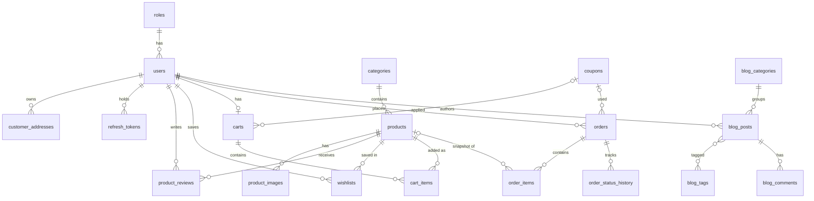

# Ogani Food Store

An online grocery store: a **Spring Boot 4 REST API** backed by **PostgreSQL**, with a storefront based on the
[Ogani](https://colorlib.com/wp/template/ogani/) template and an admin dashboard based on
[Spark Admin](https://themewagon.com/). The database and API are designed from the screens of the storefront
(shop grid, product details, cart, checkout, blog, contact).

> **Status: work in progress.** The database, entities, authentication and the catalog API are done and tested.
> The storefront is not wired to the API yet. See the [roadmap](#roadmap).

<!-- Add screenshots here, e.g.  -->

## Features

**Implemented**
- JWT authentication: register, login, refresh-token rotation (refresh tokens are stored as SHA-256 hashes), logout
- Role-based access control: `ADMIN`, `STAFF`, `CUSTOMER`
- Public catalog API: product listing with keyword search, category / price filters, sale and featured flags, sorting and pagination
- Product details by slug, category list
- Admin product API: create, read, update (ADMIN and STAFF), delete (ADMIN only)
- Consistent JSON responses and centralized error handling (400 with field errors, 401, 403, 404, 409)
- Optimistic locking on products (`@Version`), as the base for safe stock deduction at checkout
- Database versioning with Flyway, OpenAPI / Swagger UI
- Unit tests and a Testcontainers integration test that runs the real migrations on PostgreSQL

**Designed in the database, API still to build:** cart, coupons, checkout and orders (with status history),
product reviews, wishlist, customer addresses, blog (posts, tags, comments), banners, contact messages,
newsletter, store settings. JPA entities for all of them already exist.

## Tech stack

| Area | Technology |
|---|---|
| Language / framework | Java 17, Spring Boot 4.1 (Spring Framework 7) |
| Persistence | Spring Data JPA, Hibernate 7, PostgreSQL, Flyway |
| Security | Spring Security 7, JWT (jjwt) |
| Mapping / validation | MapStruct, Bean Validation |
| API docs | springdoc-openapi (Swagger UI) |
| Testing | JUnit 5, Mockito, Spring MockMvc, Testcontainers |
| Tooling | Maven, Docker / Docker Compose, GitHub Actions |
| Frontend | HTML/CSS/JS: Ogani storefront, Spark admin (static) |

## Project structure

```
ogani-food-store/
├── backend/     Spring Boot application (package-by-module: common, security, auth, user, catalog, order, content)
├── database/    PostgreSQL schema and seed (reference copies; Flyway migrations in backend/ are the source of truth)
├── admin/       Admin dashboard (Spark Admin adapted for the store; static HTML, sample data)
├── frontend/    Ogani storefront template (to be wired to the API)
└── .github/     CI workflow
```

Each backend module follows the same layers: `controller → service → repository → entity`, with `dto` and `mapper` (MapStruct).
The `catalog` module is the reference implementation.

## Database

24 tables, created and seeded by Flyway (`backend/src/main/resources/db/migration`). Core relationships:



Design notes: `order_items` and `orders` keep a **snapshot** of price, product name and shipping address, so later changes never rewrite history;
`products.avg_rating / review_count / sold_count` are denormalized for fast "top rated" queries; "latest" and "sale" lists are derived from `created_at` and `sale_price`.

## Getting started

**Requirements:** JDK 17+, Maven 3.9+, PostgreSQL (pgAdmin 4 optional). Docker is only needed for integration tests or if you do not have PostgreSQL.

1. Create an **empty** database named `ogani_store` (in pgAdmin: *Databases → Create → Database…*).
2. Set the connection through environment variables (defaults: `localhost:5432`, user `postgres`, password `postgres`):
   ```bash
   # Linux / macOS
   DB_PASSWORD=your-password mvn -f backend/pom.xml spring-boot:run
   # PowerShell
   $env:DB_PASSWORD="your-password"; mvn -f backend/pom.xml spring-boot:run
   ```
   Other variables: `DB_URL`, `DB_USER`, `JWT_SECRET` (use a random string of at least 32 characters outside local development).
3. Flyway creates the tables and sample data on first start. Open **http://localhost:8080/swagger-ui.html**.

No local PostgreSQL? `docker compose -f backend/docker-compose.yml up db` starts one on port 5433 (set `DB_URL=jdbc:postgresql://localhost:5433/ogani_store`).

**Sample accounts** (password `123456`): `admin@ogani.local` (ADMIN), `staff@ogani.local` (STAFF), `eleanor@example.com` (CUSTOMER).

**Storefront and admin:** open `frontend/` or `admin/` with any static server (e.g. VS Code Live Server on port 5500, which the API allows via CORS).

## API overview

| Method | Path | Access |
|---|---|---|
| POST | `/api/auth/register`, `/login`, `/refresh`, `/logout` | public |
| GET | `/api/auth/me` | authenticated |
| GET | `/api/categories` | public |
| GET | `/api/products` | public |
| GET | `/api/products/{slug}` | public |
| GET, POST, PUT | `/api/admin/products` | ADMIN, STAFF |
| DELETE | `/api/admin/products/{id}` | ADMIN |

`GET /api/products` query parameters: `keyword`, `categoryId`, `minPrice`, `maxPrice`, `onSale`, `featured`,
`sort` (`latest` · `price_asc` · `price_desc` · `rating` · `popular`), `page`, `size`.

Example: `GET /api/products?categoryId=2&onSale=true&sort=price_asc&page=0&size=12`

## Testing

```bash
mvn -f backend/pom.xml test      # unit tests
mvn -f backend/pom.xml verify    # + integration tests (Testcontainers, requires Docker)
```

`ProductApiIT` starts a PostgreSQL container, runs the Flyway migrations and checks the public API, validation and role-based access end to end.
The same command runs in GitHub Actions on every push.

## Roadmap

- [x] Database schema, seed data, Flyway migrations
- [x] JPA entities for all tables
- [x] Authentication (JWT + refresh token rotation) and role-based access
- [x] Catalog API (public + admin) with filtering, sorting, pagination
- [x] Admin dashboard UI adapted from Spark
- [ ] Cart and coupons
- [ ] Checkout: one transaction with stock deduction (optimistic locking), price/address snapshot and status history
- [ ] Order management with a status state machine
- [ ] Reviews, wishlist, customer addresses
- [ ] Blog, banners, contact form, newsletter, store settings
- [ ] Connect the storefront and admin pages to the API
- [ ] Payment sandbox (PayPal / VNPay), caching, order confirmation emails

## Credits

- Storefront template **Ogani** by [Colorlib](https://colorlib.com/); see `frontend/readme.txt` for its license terms.
- Admin template **Spark Admin** by ThemeWagon (MIT license).
- Sample images come from the Ogani template.
